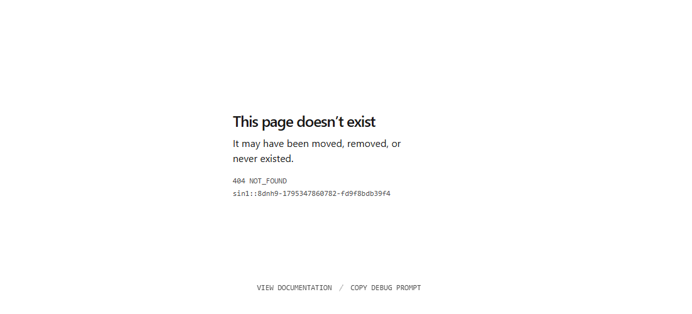

# Phase 7.1 Test Results

Acceptance test run for Second Daze Apparel, covering US-01 to US-07 and task-list items 1.3–6.6. Test cases and steps: [test-cases.md](./test-cases.md). Security checklist: [security-review.md](./security-review.md).

## Summary

| | Result |
|---|---|
| Date | 2026-11-22 |
| Test cases | 82 (80 from the test sheet, TC-01 to TC-79 plus TC-16b, and 2 security checks, SEC-08 and SEC-10) |
| **Pass** | **80** (TC-17 passed after the add-product form was built; see below) |
| Fail | 0 |
| Blocked | 0 |
| Not run | 2 (TC-69, TC-74: need *Delete all data* on the shared database) |
| Defects found | 1 critical (DEF-01), **fixed and deployed**; confirmed by Run 3 on the live site |
| Unit tests | 35 backend + 28 frontend pass; production build succeeds |

**Verdict:** the code passes every test that could be run, **and the deployed site gives exactly the same results** (Run 3: 80 Pass, 2 Not run, on the live URL). The first deployment attempt of the fix failed on Vercel (conflicting route files); this was fixed in commit `77c42bc` and deployed.

## Where and how it was tested

| Run | Target | Code | Result |
|---|---|---|---|
| 1. Live site | https://second-daze-apparel.vercel.app (Vercel, commit `d363e31`) | as deployed | 14 Pass / 57 Fail / 1 Blocked / 1 Not run: stopped by DEF-01 |
| 2. Local server | `scripts/local-server.mjs` on http://localhost:3000 | working tree with all Phase 7 fixes | 79 Pass / 0 Fail / 1 Blocked / 2 Not run. TC-17 was fixed afterwards. |
| 3. Live site, after the fix | https://second-daze-apparel.vercel.app (Vercel, commit `77c42bc`) | deployed fix, same database | **80 Pass / 0 Fail / 0 Blocked / 2 Not run: same as Run 2.** 71 API checks (`phase7-live-test.mjs`, [live-site-run3.json](./test-results/live-site-run3.json)) + 8 browser checks (`phase7-ui-test.mjs`, [live-ui-checks.json](./test-results/live-ui-checks.json)) + TC-17 (live check below) + the 2 SEC checks inside the API script. Screenshots: [screenshots/live/](./screenshots/live/) |

All three runs used the **real TiDB Cloud database** (`second_daze`) that the Vercel deployment uses, so data, schema and stock rules were the production ones. The local server sends every `/api/*` request to the same router file the Vercel functions use; only the Vercel URL-to-file matching is skipped.

- **API tests** (TC-01 to TC-76, SEC-08, SEC-10): `scripts/phase7-live-test.mjs` signs in as each role over HTTP, performs every workflow step and checks the result in the API response **and** in the database (stock, reserved and defective quantities, notifications, documents, audit log).
- **Browser tests** (TC-13, TC-14, TC-43, TC-67, TC-68, TC-77, TC-78, TC-79) and screenshots: `scripts/phase7-ui-test.mjs`, Microsoft Edge driven by Playwright, desktop 1440×900 and phone 375×812. Run on the local server (Run 2) and again on the live site (Run 3).
- **Data:** existing data was kept. Tests created only records named `TEST…` (products TEST-001/002/003, customers *TEST Ana Cruz* and *TEST Ben Reyes*) and the temporary accounts `qa_admin`, `qa_sales`, `qa_inventory`. These were removed / disabled afterwards with `scripts/phase7-cleanup.mjs` (see *Cleanup*).
- **Simulated steps:** TC-09 (forgot password): no mailbox was available, so the reset token was written to `password_resets` the same way the app does it and then used through the real reset endpoint. TC-57 (expiry): the reservation's `expiry_date` was moved into the past instead of waiting days; the reminder was produced by the same function the daily cron calls.

## Defects

### DEF-01 (critical): action buttons returned 404 on the live site (fixed and deployed)

| | |
|---|---|
| Found by | Run 1 (live site): TC-03, TC-10, TC-11, TC-21, TC-22, TC-24, TC-58 and everything depending on them |
| Symptom | Every API path with 3+ segments returns Vercel's own page *"404 NOT_FOUND"*: approve / disable / enable / reset a user, add stock, edit or delete a product, every order, reservation, refund and customer row action, and the daily cron `/api/operations/maintenance`. In the browser these buttons fail with an error.  |
| Cause | On this Vercel project a file named `[...route].js` only matches **one** path segment. `api/users/[...route].js` therefore serves `/api/users/5` but not `/api/users/5/approve`. Earlier fixes (`4167dca`, `f08454f`) were only tested in Node, not on Vercel. |
| Fix | Added files with explicit dynamic segments that reuse the same router: `api/users/[id]/[action].js`, `api/data/[kind]/[id].js`, `api/data/[kind]/[id]/[action].js`, `api/operations/maintenance.js`. Regression test *"every API route has a Vercel function file that serves its path"* in `api/data/route.test.js` fails without these files. |
| Status | **Closed.** Verified by Run 2 (local) and Run 3 (live site: all API and browser checks pass). Deployment note: the first push (`37a27a6`) failed on Vercel with *"conflicting paths: api/data/[kind]/[id]/[action].js vs api/data/[...route].js"*. Commit `77c42bc` replaced the folder catch-alls with exact-depth files (`api/data/[kind].js`, `api/export/[name].js`); a new test checks that no catch-all shares a folder with nested routes. |

### Security findings from the Phase 7.3 review

In Run 1 (before the fix), TC-09, TC-15, TC-16, TC-16b, TC-75 and SEC-10 also failed on the live site, but only as a knock-on effect of DEF-01: the QA Sales and Inventory accounts could not be approved, so their requests got *401 Please log in*. After the fix they pass on both the local server (Run 2) and the live site (Run 3). Details: [security-review.md](./security-review.md).

## Results per test

Live, Run 1 = deployed site before the fix. Live, Run 3 = deployed site after the fix (API script plus browser checks). Local, Run 2 = fixed code on a local server, same database. TC-17 was added after Run 2 (form built) and checked on the live site. "—" = not part of that run.

| ID | Test | Live, Run 1 (before fix) | Live, Run 3 (after fix) | Local, Run 2 | Actual result (Run 2) |
|---|---|---|---|---|---|
| TC-01 | Admin creates Sales and Inventory subaccounts | Pass | **Pass** | **Pass** | 201 Created for both; status Pending Approval; 12-character temporary password returned once (e.g. length 12). |
| TC-02 | Pending account cannot sign in | Pass | **Pass** | **Pass** | HTTP 403 "This account is not active. Please contact the Admin." |
| TC-03 | Admin approves both accounts | Fail | **Pass** | **Pass** | Both approved (HTTP 200); user list shows status Active. |
| TC-04 | First sign-in forces a password change | Fail | **Pass** | **Pass** | Login 200 with mustChangePassword=true; workspace data refused before the change (HTTP 403 "You must change your password first."). |
| TC-05 | Weak new password is rejected | Fail | **Pass** | **Pass** | "password" → HTTP 400 "Password must be 8-72 characters with an uppercase letter, a lowercase letter, a number and a symbol.". A strong password was accepted (200) and the workspace opened. |
| TC-06 | Wrong password is refused | Pass | **Pass** | **Pass** | HTTP 401 "Invalid username or password." |
| TC-07 | Signed-out user gets no data | Pass | **Pass** | **Pass** | GET /api/data/records → HTTP 401 "Please log in."; site root → HTTP 200 (sign-in screen, see screenshot). |
| TC-08 | Logout ends the browser session | Pass | **Pass** | **Pass** | Logout cleared the cookie; /api/me → HTTP 401 "Please log in.". Replaying a copied old cookie → HTTP 200 (accepted risk, see security review #4). |
| TC-09 | Forgot / reset password | Fail | **Pass** | **Pass** | Unknown and known accounts get the same reply ("If the account has an email on file, a reset link has been sent."). Token reset: first use 200, reuse HTTP 400 "This reset link is invalid or has expired.", expired HTTP 400 "This reset link is invalid or has expired.". Email delivery not checked (no staff mailbox on file). |
| TC-10 | Disabled account cannot sign in; re-enable restores it | Fail | **Pass** | **Pass** | Disabled: login HTTP 403 "This account is not active. Please contact the Admin."; existing session /api/me → HTTP 401. Enabled: login HTTP 200. |
| TC-11 | Admin resets a password; old sessions end | Fail | **Pass** | **Pass** | New temporary password returned; old session → HTTP 401 "Please log in."; next login requires a password change. |
| TC-12 | Each role signs in with its own role | Fail | **Pass** | **Pass** | qa_admin=Admin, qa_sales=Sales Management, qa_inventory=Inventory Management. Dashboards and navigation: see screenshots. |
| TC-13 | Sales cannot open Admin screens by URL | — | **Pass** | **Pass** | Redirected: 2.1-subaccounts → #/3-sales-dashboard; 2.7-csv-import → #/3-sales-dashboard; 2.9-data-export → #/3-sales-dashboard; 7-staff-accounts → #/3-sales-dashboard |
| TC-14 | Inventory cannot open customer/order/reservation screens by URL | — | **Pass** | **Pass** | Redirected: 3.11-customers → #/4-inventory-dashboard; 3.9-orders-status-tracking → #/4-inventory-dashboard; 5-reservations → #/4-inventory-dashboard; 3.13-create-purchase-order → #/4-inventory-dashboard |
| TC-15 | Sales cannot call Admin APIs | Fail | **Pass** | **Pass** | GET users → 403; POST data/import → 403; GET export/customers → 403; POST users → 403 |
| TC-16 | Inventory cannot submit sales forms | Fail | **Pass** | **Pass** | HTTP 403 "You do not have access to this." |
| TC-16b | Inventory does not receive customer contact details | Fail | **Pass** | **Pass** | customers empty; orders have no contact number or address. |
| TC-17 | Inventory adds a product manually | Blocked | **Pass** | **Pass** (after fix) | No form existed during the runs. The *Add product* form was then built (Admin and Inventory). Checked against the real database: TEST-ADD-1 saved with stock 6 and a Stock In movement; a repeated code gave HTTP 409. The test product was deleted. Re-tested on the live site in Run 3 (see *Run 3: live check of TC-17*). |
| TC-18 | Admin imports the TEST products | Pass | **Pass** | **Pass** | Imported 2 rows, created 2, stock added 14. TEST-001 stock 10, TEST-002 stock 4. |
| TC-19 | Same product file cannot be imported twice | Pass | **Pass** | **Pass** | HTTP 409 "This product file was already imported, so its stock was not added again. Change the quantities to import a new shipment."; stock unchanged (10). |
| TC-20 | Inventory sees product details | Fail | **Pass** | **Pass** | TEST-001: TEST Denim jacket, Outerwear, M, cost 200, price 500, stock 10, In stock. |
| TC-21 | Inventory adds stock | Fail | **Pass** | **Pass** | Stock 10 → 15; Stock In movement +5 recorded. |
| TC-22 | Invalid stock quantities are refused | Fail | **Pass** | **Pass** | 0 → 400, -1 → 400, abc → 400; stock still 15. |
| TC-23 | Admin edits a price; old orders keep theirs | Fail | **Pass** | **Pass** | Selling price now ₱550; ORD-2026-00001 still ₱500 per unit. |
| TC-24 | Non-admins cannot edit products | Fail | **Pass** | **Pass** | Sales form HTTP 403 "Only an Admin can edit products."; Inventory form HTTP 403 "You do not have access to this."; Sales PUT 403. |
| TC-25 | Low-stock list | Fail | **Pass** | **Pass** | TEST-002 status "Low stock". |
| TC-26 | Low stock notification for Inventory | Fail | **Pass** | **Pass** | TEST-002 stock 3 ≤ threshold 3; "Low Stock" notification visible to Inventory. |
| TC-27 | Threshold 0 removes the low-stock flag | Fail | **Pass** | **Pass** | TEST-002 status now "In stock". |
| TC-28 | New customer with 09 number | Fail | **Pass** | **Pass** | Saved; status Unverified. |
| TC-29 | New customer with +63 number and spaces | Fail | **Pass** | **Pass** | Saved as +639990001002. |
| TC-30 | Invalid mobile numbers are refused | Fail | **Pass** | **Pass** | 12345 → 400; 0817123456 → 400; (02) 8123 4567 → 400 |
| TC-31 | Missing address fields are refused | Fail | **Pass** | **Pass** | City blank HTTP 400 "City is required."; Province blank HTTP 400 "Province is required.". |
| TC-32 | Duplicate number (other format) is refused | Fail | **Pass** | **Pass** | HTTP 409 "A customer with that contact number already exists." |
| TC-33 | Sales verifies the customer | Fail | **Pass** | **Pass** | TEST Ana Cruz → Verified. |
| TC-34 | Sales creates a multi-item purchase order | Fail | **Pass** | **Pass** | ORD-2026-00001 (PO-2026-00001) Pending Approval; items TEST-001×2 @500.00/cost 200.00, TEST-002×1 @400.00/cost 150.00; Admin notified. |
| TC-35 | Order larger than stock is refused | Fail | **Pass** | **Pass** | HTTP 409 "Only 15 of TEST Denim jacket available." |
| TC-36 | Bad additional-items format is refused | Fail | **Pass** | **Pass** | HTTP 400 "Additional item "TEST-002 two" must look like "PRODUCT-CODE x 2"." |
| TC-37 | Admin approves the order | Fail | **Pass** | **Pass** | Order status Pending Payment. |
| TC-38 | Sales records a GCash payment | Fail | **Pass** | **Pass** | Payment TEST1795347411823 ₱1400.00 Pending Verification; Admin notified. |
| TC-39 | Duplicate GCash reference is refused | Fail | **Pass** | **Pass** | ORD-2026-00002: reusing TEST1795347411823 → HTTP 409 "That GCash reference number was already used.". |
| TC-40 | Admin rejects the payment | Fail | **Pass** | **Pass** | Payment Rejected ("TEST reference not found in GCash"); order still Pending Payment; Sales user notified. |
| TC-41 | Verified payment deducts stock and issues the invoice | Fail | **Pass** | **Pass** | Order Paid; INV-2026-00001 issued; TEST-001 15 → 13, TEST-002 4 → 3; 2 Sale movements. |
| TC-42 | Sales documents: PO and invoice only after payment | Fail | **Pass** | **Pass** | ORD-2026-00001: Invoice, Purchase Order. ORD-2026-00002 (unpaid): Purchase Order only. |
| TC-43 | Print for packer | — | **Pass** | **Pass** | Print page (opened by Sales) shows TEST Ana Cruz, 123 Test St., TEST-001, TEST-002; quantities: shown. |
| TC-44 | Cancel an unpaid order | Fail | **Pass** | **Pass** | ORD-2026-00002 Cancelled; TEST-002 stock unchanged (3). |
| TC-45 | Cannot ship to an unverified customer | Fail | **Pass** | **Pass** | Packed; ship → HTTP 409 "Verify the customer's information before shipping.". |
| TC-46 | Ship with tracking number | Fail | **Pass** | **Pass** | Order Shipped; tracking JT-TEST-001 saved. |
| TC-47 | Mark in transit | Fail | **Pass** | **Pass** | Shipment In Transit. |
| TC-48 | Confirm delivery issues a delivery receipt | Fail | **Pass** | **Pass** | Order Delivered; DR-2026-00001 issued. |
| TC-49 | Returned parcel | Fail | **Pass** | **Pass** | ORD-2026-00003: shipment Returned ("Returned to sender"); customer returned parcels 1, back to Unverified; no DR. |
| TC-50 | Complete the delivered order | Fail | **Pass** | **Pass** | Order Completed. |
| TC-51 | Sales creates a reservation | Fail | **Pass** | **Pass** | RES-2026-00001 Pending Approval (2 agreed days); Admin notified. |
| TC-52 | Invalid agreed days are refused | Fail | **Pass** | **Pass** | "0" → 400; "256" → 400; "" → 400 |
| TC-53 | Approval holds stock and sets expiry | Fail | **Pass** | **Pass** | Active; expiry 48.0 h after approval; stock 12 → 11, reserved 0 → 1. |
| TC-54 | Rejecting a reservation leaves stock alone | Fail | **Pass** | **Pass** | RES-2026-00002 Rejected; stock unchanged. |
| TC-55 | Cancelling an active reservation releases stock | Fail | **Pass** | **Pass** | RES-2026-00003 Cancelled; stock 10 → 11, reserved 2 → 1. |
| TC-56 | Reservation converted to a paid order | Fail | **Pass** | **Pass** | ORD-2026-00004 Paid; reservation Paid; stock unchanged (11), reserved 1 → 0 (no double deduction). |
| TC-57 | Expired reservation is voided; reminder sent | Fail | **Pass** | **Pass** | RES-2026-00004 Voided (Expired); stock 10 → 11; creator notified. RES-2026-00005 (expires in 24 h): reminder sent (1 total), then cancelled. |
| TC-58 | Maintenance endpoint needs the cron secret | Fail | **Pass** | **Pass** | No header → 401; wrong secret → 401; correct secret → 200. |
| TC-59 | Sales requests a refund | Fail | **Pass** | **Pass** | RFD-2026-00001 Pending Approval, ₱500.00; Admin notified. |
| TC-60 | Invalid refund requests are refused | Fail | **Pass** | **Pass** | Cancelled order → HTTP 409 "This order is already Cancelled."; quantity 5 of 2 → HTTP 400 "Only 2 of this item was ordered.". |
| TC-61 | Approved good item returns to stock | Fail | **Pass** | **Pass** | Approved; TEST-001 stock 11 → 12; Refund Return movement. |
| TC-62 | Approved damaged item goes to defective | Fail | **Pass** | **Pass** | RFD-2026-00002 approved; TEST-002 stock unchanged (3); defective 0 → 1. |
| TC-63 | Rejected refund leaves inventory alone | Fail | **Pass** | **Pass** | RFD-2026-00003 Rejected; inventory unchanged. |
| TC-64 | Sales and profit include the TEST orders | Fail | **Pass** | **Pass** | Gross TEST sales ₱2,400, cost ₱950, approved refunds ₱900 → dashboard net sales +₱1500 and profit +₱550, as calculated by hand. |
| TC-65 | Approved refunds reduce net sales and profit | Pass | **Pass** | **Pass** | Covered in TC-64: the ₱900 of approved refunds was subtracted from sales and profit. |
| TC-66 | Dashboard counts match the records | Pass | **Pass** | **Pass** | Pending orders 42, unpaid reservations 26, for shipping 33, completed 47: all equal to counts from the record lists. |
| TC-67 | Reports weekly view | — | **Pass** | **Pass** | Friday review: 11/16/2026 – 11/21/2026. Switching Friday review week → All-time changes the totals (different). |
| TC-68 | Sales, Financial, Order and Stock reports load | — | **Pass** | **Pass** | Sales: loaded; Financial: loaded; Orders: loaded; Stock: loaded; browser console errors: 0. |
| TC-69 | Empty database shows zeros | — | Not run | **Not run** | Needs Delete all data on the shared database; not run by decision (existing data kept). No automated test covers it yet. |
| TC-70 | CSV export of every record type | Pass | **Pass** | **Pass** | All 13 tables exported as CSV (rows: products 42, customers 203, orders 204, order_items 627, payments 123, shipments 81, reservations 85, refunds 15, stock_movements 316, invoices 164, purchase_orders 74, delivery_receipts 25, audit_log 146). Excel download checked in the browser. |
| TC-71 | Formula-like values are exported as text | Pass | **Pass** | **Pass** | Product name "=1+1" exported as '=1+1 (spreadsheets show it as text). |
| TC-72 | Bad import files are refused | Pass | **Pass** | **Pass** | Missing/invalid columns → HTTP 400 "Data row 1: Product is required."; unsupported type → 400; empty file → 400; nothing saved. |
| TC-73 | Delete all data: button disabled without the phrase | Pass | **Pass** | **Pass** | Checked in the browser (see screenshot). Server also refuses without the phrase (unit test). |
| TC-74 | Delete all data | Not run | Not run | **Not run** | Not run on the live database by decision (existing data kept). Covered by the route test and the manual check in TC-73. |
| TC-75 | Sales cannot run Delete all data | Fail | **Pass** | **Pass** | HTTP 403 "You do not have access to this." |
| TC-76 | Each role sees only its own notifications | Fail | **Pass** | **Pass** | Admin: Approval/Payment/Refund; Sales: Payment/Refund/Reservation; Inventory: Low Stock. Mark all read → Inventory unread count 0. |
| TC-77 | No quotation wording, no pickup fields | — | **Pass** | **Pass** | Checked Sales documents, Reservations, New reservation, New purchase order and Catalog: no "quotation", no pickup fields. |
| TC-78 | 375 px layout | — | **Pass** | **Pass** | Edge 375×812 emulation: qa_admin 2-admin-dashboard: page width 375/375; qa_admin 3.9-orders-status-tracking: page width 375/375; qa_sales 3-sales-dashboard: page width 375/375; qa_sales 3.13-create-purchase-order: page width 375/375; qa_sales 5.1-new-reservation: page width 375/375; qa_inventory 4-inventory-dashboard: page width 375/375; qa_inventory 4-inventory-workspace: page width 375/375. Wide tables scroll inside their own box. Real-phone check still to do by the team. |
| TC-79 | /mobile opens the same app | — | **Pass** | **Pass** | /mobile → sign-in form (no hash); after sign-in as Sales → #/3-sales-dashboard. |
| SEC-08 | Five failed logins lock the account | Pass | **Pass** | **Pass** | After 5 wrong passwords the correct password gets HTTP 423 "Too many failed attempts. Try again in a few minutes."; 5 login_failed audit entries. (Unlocked in the DB afterwards.) |
| SEC-10 | Long text and markup in input | Fail | **Pass** | **Pass** | Name over 100 characters → HTTP 400 "Customer must be 100 characters or fewer.". Markup is shown as text by React (see screenshot of the customer list). |

## Screenshots

Most screenshots were taken during Run 2 (local server) with the TEST data in place and are stored in [screenshots/](./screenshots/). The live site was re-checked in Run 3 and its screenshots are in [screenshots/live/](./screenshots/live/): [30](./screenshots/live/30-sales-home.png), [40](./screenshots/live/40-inventory-home.png), [17](./screenshots/live/17-order-detail.png), [17b](./screenshots/live/17b-print-for-packer.png), [22b](./screenshots/live/22b-reports-weekly.png), [22c](./screenshots/live/22c-reports-all-time.png) and the four report tabs. The Add product screens are [42b](./screenshots/42b-inventory-add-product-button.png), [42c](./screenshots/42c-add-product-form-filled.png) and [42d](./screenshots/42d-add-product-confirm.png).

| Screen | Desktop | Notes |
|---|---|---|
| Sign in / wrong password | [01](./screenshots/01-sign-in.png), [02](./screenshots/02-sign-in-error.png) | TC-06, TC-07 |
| Admin dashboard | [10](./screenshots/10-admin-dashboard.png) | TC-12, TC-64–66 |
| Subaccounts, Access approvals | [11](./screenshots/11-admin-subaccounts.png), [12](./screenshots/12-admin-access-approvals.png) | TC-01, TC-03 |
| Products, Low stock | [13](./screenshots/13-inventory-products.png), [14](./screenshots/14-low-stock.png) | TC-18, TC-25 |
| Customers | [15](./screenshots/15-customers.png) | TC-28–33 |
| Orders, order details, print for packer | [16](./screenshots/16-orders.png), [17](./screenshots/17-order-detail.png), [17b](./screenshots/17b-print-for-packer.png) | TC-34–50, TC-43 |
| Reservations, Refunds | [18](./screenshots/18-reservations.png), [19](./screenshots/19-refunds.png) | TC-51–63 |
| Sales documents, Sales | [20](./screenshots/20-sales-documents.png), [21](./screenshots/21-sales.png) | TC-41, TC-42 |
| Reports (summary, weekly, all-time, each tab) | [22](./screenshots/22-reports.png), [22b](./screenshots/22b-reports-weekly.png), [22c](./screenshots/22c-reports-all-time.png), [sales](./screenshots/22-report-sales.png), [financial](./screenshots/22-report-financial.png), [orders](./screenshots/22-report-orders.png), [stock](./screenshots/22-report-stock.png), [analytics](./screenshots/23-reports-analytics.png) | TC-67, TC-68 |
| Import CSV, Export / Delete all | [24](./screenshots/24-csv-import.png), [25](./screenshots/25-export-and-delete-all.png), [26](./screenshots/26-delete-all-disabled.png) | TC-70–73 |
| Notifications (Admin, Sales) | [27](./screenshots/27-notifications-admin.png), [35](./screenshots/35-sales-notifications.png) | TC-76 |
| Sales role screens | [30](./screenshots/30-sales-home.png), [31](./screenshots/31-sales-new-customer.png), [32](./screenshots/32-sales-new-order.png), [33](./screenshots/33-sales-new-reservation.png), [34](./screenshots/34-sales-refund-request.png) | TC-12, TC-13 |
| Inventory role screens | [40](./screenshots/40-inventory-home.png), [41](./screenshots/41-inventory-products.png), [42](./screenshots/42-inventory-low-stock.png) | TC-12, TC-14 (no Orders/Customers in the menu) |
| Phone 375 px | [50](./screenshots/50-sign-in-375px.png), [51](./screenshots/51-dashboard-375px.png), [52](./screenshots/52-approvals-375px.png), [53](./screenshots/53-orders-375px.png), [54](./screenshots/54-low-stock-375px.png), [57](./screenshots/57-new-order-375px.png), [58](./screenshots/58-new-reservation-375px.png), [59](./screenshots/59-inventory-375px.png) | TC-78, TC-79 |
| Live-site defect (Run 1, before the fix) | [60](./screenshots/60-live-nested-api-404.png) | DEF-01 |

## Open items for the team

1. ~~Deploy the fixes and re-run against the live URL~~ Done (Run 3).
2. ~~TC-17~~ Done: tested on the live site as Inventory (see *Run 3: live check of TC-17*).
3. **TC-69 / TC-74 (Not run):** run *Delete all data* only on a copy of the database, or right before go-live.
4. **TC-78:** also check on a real phone (only 375 px emulation was done).
5. `CRON_SECRET` is set in Vercel (confirmed by the team). The correct-secret case of TC-58 was tested locally only; the maintenance endpoint now answers 401 without the secret on the live site.
6. Rotate the TiDB password (it was shared in chat during testing).
7. ~~Create a real Admin~~ Done: Admin `sd_admin` was created (temporary password, must be changed at first sign-in). The weak `admin`/`staff` accounts were disabled after testing (see *Cleanup*).

## How to re-run

Run from the repository root in PowerShell. Never commit passwords.

```powershell
# database connection (same values as in Vercel)
$env:DB_HOST="…"; $env:DB_PORT="4000"; $env:DB_USER="…"; $env:DB_PASSWORD="…"; $env:DB_NAME="second_daze"

# optional: local server instead of the live site
$env:SESSION_SECRET="<long random text>"; $env:CRON_SECRET="<random>"
npm run build; node scripts/local-server.mjs        # in a second terminal

$env:LIVE_URL="https://second-daze-apparel.vercel.app"   # or http://localhost:3000
$env:QA_ADMIN_PASSWORD="<strong password>"
$env:QA_CREDS_FILE="C:\temp\qa-creds.json"             # outside the repo
$env:QA_RESULTS_FILE="docs/test-results/live-site-run.json"
node scripts/phase7-live-test.mjs

# browser checks (TC-13, 14, 43, 67, 68, 77, 78, 79); Playwright is installed outside the repo
$env:PLAYWRIGHT_DIR="C:\temp\pw"; $env:BASE_URL=$env:LIVE_URL   # npm i playwright-core in that folder
$env:SHOT_DIR="docs/screenshots/live"; $env:UI_RESULTS_FILE="docs/test-results/live-ui-checks.json"
node scripts/phase7-ui-test.mjs

node scripts/phase7-cleanup.mjs --free-names   # remove TEST data, disable QA accounts
```

## Run 3: live check of TC-17 (Add product)

On https://second-daze-apparel.vercel.app, signed in as the QA Inventory user: submitting the form with a new code `TEST-ADD-9` returned 200 and the product appeared with stock 6 (status *In stock*, with an *Add stock* action); submitting the same code again returned 409; submitting a Sales form (`3.12-new-customer-validation`) as Inventory returned 403. In the browser the form and the confirmation step work: [button](./screenshots/42b-inventory-add-product-button.png), [filled form](./screenshots/42c-add-product-form-filled.png), [confirmation](./screenshots/42d-add-product-confirm.png). The test products were deleted afterwards.

## Cleanup

After the runs, `scripts/phase7-cleanup.mjs` deleted all TEST products, customers, orders, payments, documents, reservations, refunds, stock movements, notifications and import records, and disabled the QA accounts (kept, not deleted, because the audit log refers to them). The audit log entries were kept as the record of testing. Document counters (ORD-, RES-, RF- numbers) have moved forward; this is expected.

Checked after cleanup: 0 `TEST-%` products, 0 TEST customers. The sample data was untouched (40 products, 201 customers, 200 orders, 80 reservations, 12 refunds). `qa_admin`, `qa_sales`, `qa_inventory` and the run-1 accounts are *Disabled*.

The weak default accounts `admin`/`admin` and `staff`/`staff` were also disabled (password hash made unusable). Logging in with them on the live site now returns HTTP 401.
