# Second Daze Apparel – User Guide

> Screenshots were taken during Phase 7 testing with sample `TEST` records. More screens are in [screenshots/](./screenshots/).

This guide explains how to use the Sales Tracking and Inventory Management System. There are three roles. Each role sees only its own screens:

| Role | Who | What they do |
|---|---|---|
| **Admin** | Owner | Accounts, approvals, payment verification, product edits, reports, import/export |
| **Sales Management** | Sales staff / live seller | Customers, orders, GCash payments, shipments, reservations, refund requests |
| **Inventory Management** | Inventory staff | Product list, stock in, low-stock monitoring |

The Packer has no account. Sales prints order details for packing.

The same website works on a computer and a phone. Old `/mobile` links open the same app.

---

## 1. Getting started (everyone)

### Signing in
1. Open the website and enter the **username** and **password** your Admin gave you.
2. The first time, you must **change your temporary password**. It must be 8–72 characters with an uppercase letter, a lowercase letter, a number and a symbol.
3. You land on your role's dashboard.

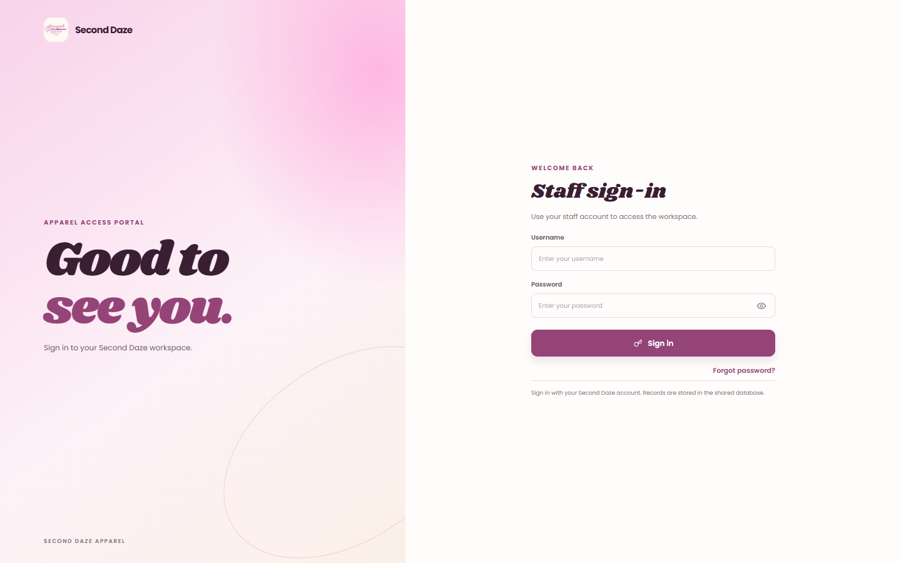

If you see **Access awaiting approval**, the Admin hasn't approved your account yet.

### Forgot password
On the sign-in screen, click **Forgot password?**, enter your username or email and follow the link in the email. The link works once and expires after 30 minutes. If you have no email on file, ask the Admin to reset your password.

### Notifications
Open **Notifications** to see low-stock alerts, approvals and reservation reminders meant for you. Click **Mark all as read** when you're done.

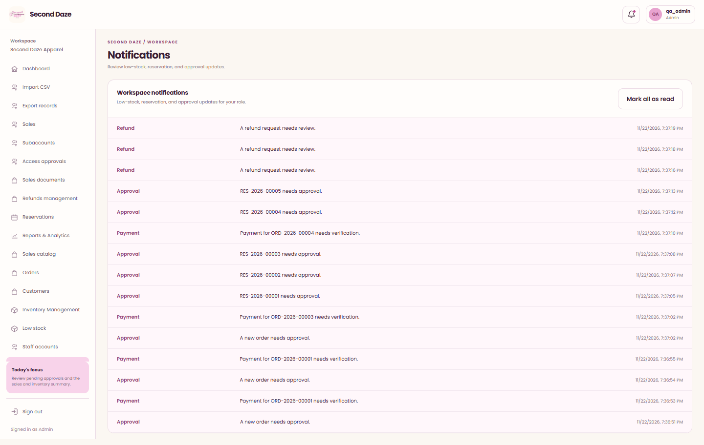

### Signing out
Always sign out on shared devices. Sessions also end automatically after 8 hours.

---

## 2. Admin

### Staff accounts
1. **Staff accounts** → **Create subaccount**: enter full name, username, optional email and role (Sales Management or Inventory Management).
2. Copy the **temporary password** shown and give it to the staff member privately. It is shown only once.
3. **Access approvals** → **Approve** the new account. The user can now sign in.
4. To block someone, click **Disable**. **Enable** restores access. **Reset password** issues a new temporary password and signs the user out everywhere.

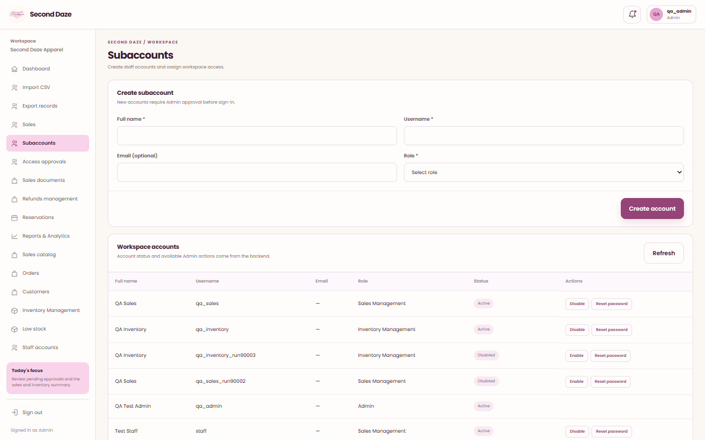

### Approving orders and verifying payments
1. **Orders**: orders created by Sales start as *Pending Approval*. Check them and click **Approve**.
2. When Sales records a GCash payment, you get a notification. Check the reference number and amount in your GCash app.
3. Click **Verify payment** if it matches. The order becomes *Paid*, an **invoice** is issued and **stock is deducted automatically**.
4. If it doesn't match, click **Reject payment** and enter the reason. Sales is notified.

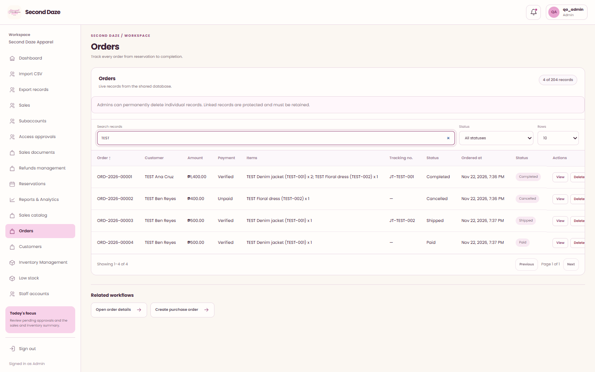

### Reservations
**Reservations** → **Approve** holds the items for the agreed number of days. **Reject** declines the request. Unpaid reservations are voided automatically when the agreed days pass, and the items go back to stock.

### Refunds
**Refunds management** → review the request (days of ownership, issue, item condition).
- **Approve**: non-defective items go back to stock; defective items are counted as defective and not returned to stock.
- **Reject**: enter a reason; inventory doesn't change.

### Products
- **Edit product** (Admin only): change name, category, size, prices, low-stock threshold and Active/Inactive status. Past orders keep their original prices.
- New products are added with **Add product** (Inventory Management screen) or through **Import CSV** (see below).

### Reports and dashboard
- **Dashboard**: total sales, total profit, pending orders, unpaid reservations, items for shipping and completed orders.
- **Reports & Analytics**: sales, financial, order and stock reports. Use **Friday review week** (Monday to Friday) or **All-time** in the **View** list.

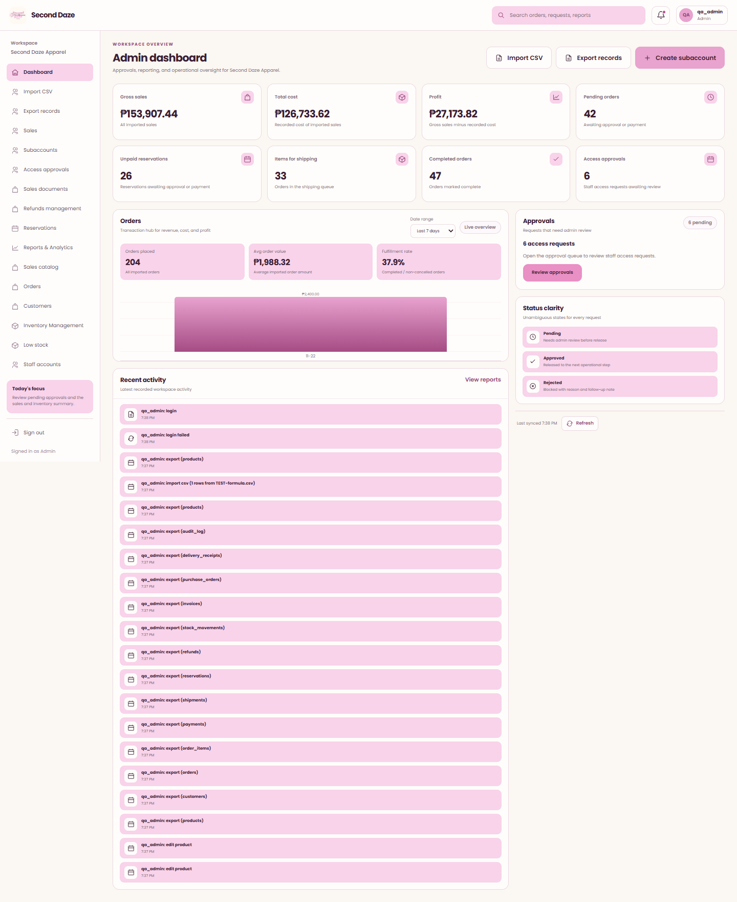

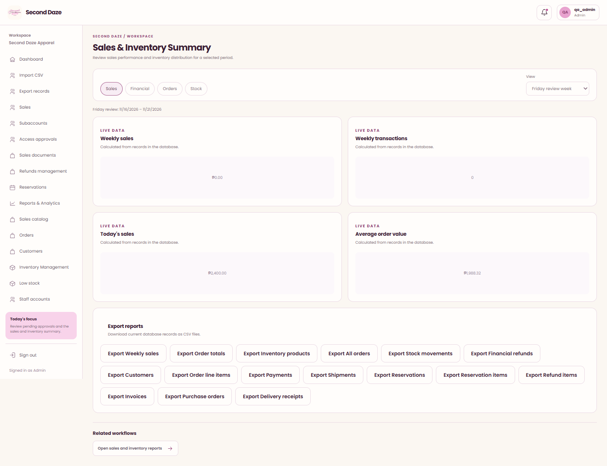

### Import and export
- **Import CSV**: choose Products or Customers, click **Download template** for the right columns, fill it in, then **Preview CSV** and **Import**. Importing an existing product code adds stock. The same file can't be imported twice.
- **Full TiDB dataset import**: use this only to add a dataset batch once. An identical batch is rejected, and customer contact numbers already in the database cannot be imported again.
- **Export records**: **Download CSV** or **Download Excel** to back up everything. Do this every week after the Friday review and keep the files somewhere private.
- **Delete all data**: permanently removes all business records but keeps staff accounts. Export first. Type `DELETE ALL DATA` to enable the button. Use this only to clear test data.

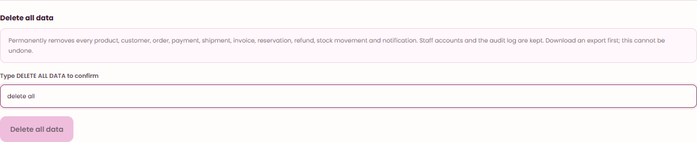

---

## 3. Sales Management

### Customers
1. **Customers** → **New customer**: full name, mobile number (`09XXXXXXXXX` or `+639XXXXXXXXX`), address, barangay, city and province are required.
2. Before shipping, confirm the details with the buyer and click **Verify info**. Orders can't ship to unverified customers.
3. If a parcel is returned, the customer goes back to *Unverified* so the details are checked again.

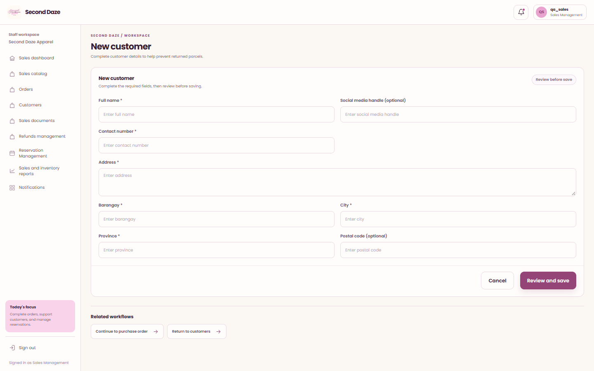

### Creating an order (purchase order)
1. **New purchase order**: choose the customer, product and quantity.
2. More items: in **Additional items** type them like `TEST-002 x 1, TEST-003 x 2`.
3. Submit. The order waits for Admin approval.

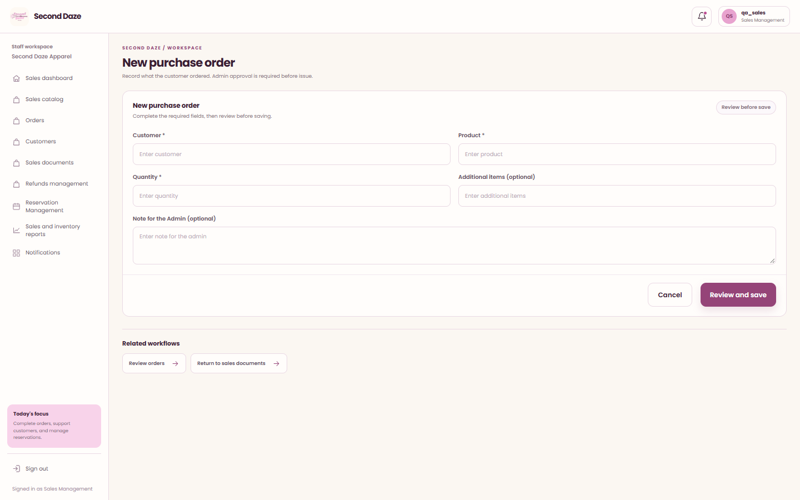

### Recording a GCash payment
1. **Orders** → find the order (*Pending Payment*) → **Record payment**.
2. Enter the **GCash reference number** exactly. A reference number can be used only once.
3. Wait for the Admin to verify it. If rejected, you'll get a notification with the reason; record the correct reference again.

### Packing and shipping
1. When the order is *Paid*, open it and click **Print for packer**. Give the printout to the Packer.

   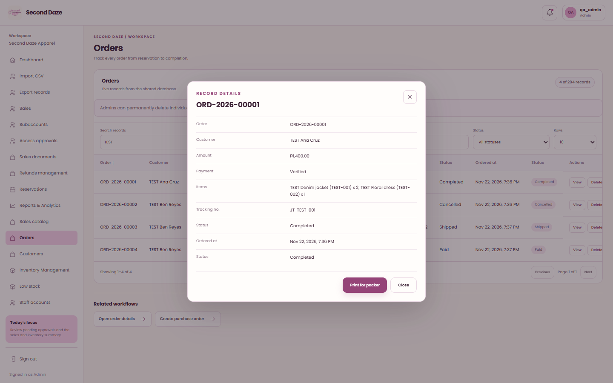
2. Click **Mark packed**.
3. After handing the parcel to J&T, click **Ship** and enter the **J&T tracking number**.
4. Click **Mark in transit** when J&T picks it up.

### Confirming delivery
**Confirm delivery**: enter the order number and choose:
- **Delivered**: enter date/time and who received it. A **Delivery Receipt** is issued. Then click **Complete** on the order.
- **Failed delivery** / **Returned to sender**: the reason is recorded and the customer must be verified again.

### Reservations
1. **New reservation**: customer, product, quantity and **agreed days** (how long to hold the item).
2. The Admin approves it and the item is held.
3. When the customer pays, open the reservation and click **Create order**, then record the payment as usual.
4. You get a reminder 24 hours before a reservation expires. Unpaid reservations are voided automatically.

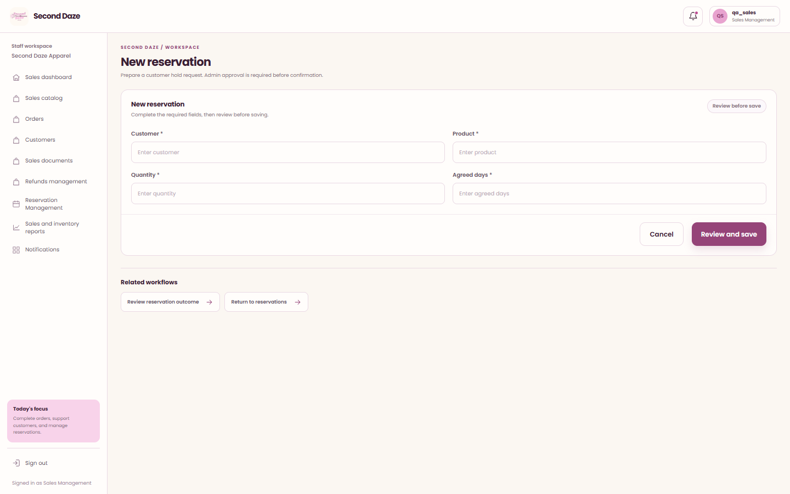

### Refund requests
1. **New refund request**: order number (must be delivered), returned item, quantity, **days of ownership**, item condition and the issue.
2. The Admin reviews and approves or rejects it.

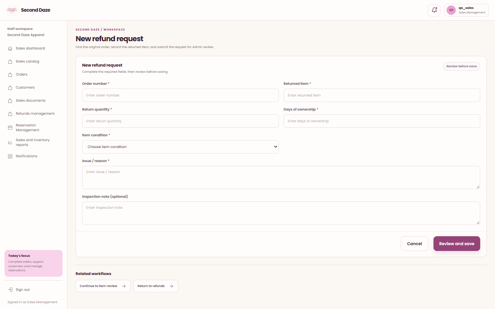

---

## 4. Inventory Management

- **Inventory Management** screen: view and search all products with stock, reserved and defective counts.
- **Add product**: click **Add product**, fill in the code, name, category, size, prices, starting stock and low-stock threshold, then **Review and save**. A code that already exists is refused; use **Add stock** instead. Admin and Inventory can add products.
- **Add stock**: click it on a product and enter the quantity received. Every change is recorded in the stock history.
- **Low stock**: items at or below their threshold. You also get a notification when an item becomes low. Restock these first.
- To change prices or details, ask the Admin.

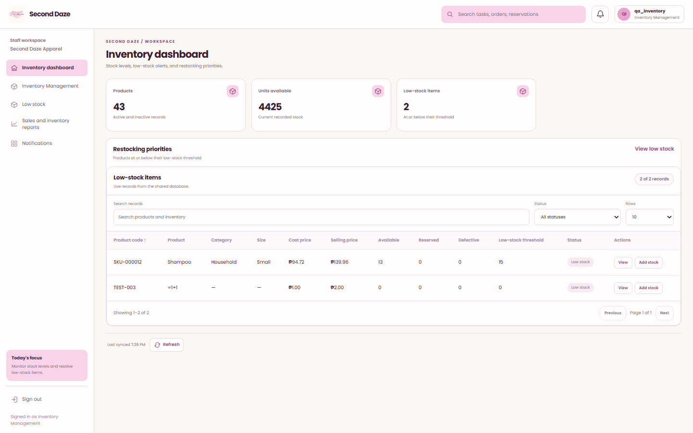

### On a phone

The same screens fit a phone. Wide tables scroll sideways inside their box.

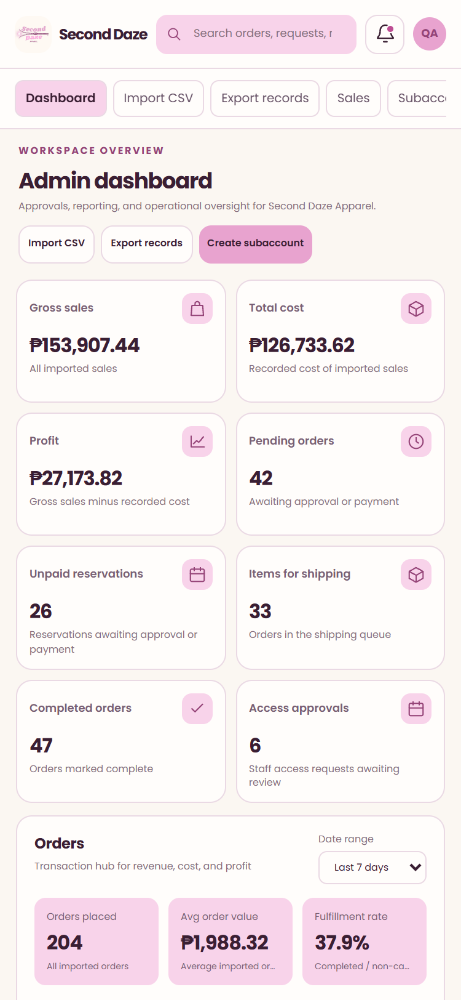

---

## 5. Common problems

| Message / problem | What to do |
|---|---|
| "Access awaiting approval" | Ask the Admin to approve your account |
| "You must change your password first" | Change your temporary password when prompted |
| "That GCash reference number was already used" | Check the reference in GCash; each payment has a unique number |
| "Verify the customer's information before shipping" | Confirm the details with the buyer, then click **Verify info** on the customer |
| "Only N of … available" | Not enough stock; reduce the quantity or ask Inventory to restock |
| "A customer with that contact number already exists" | Search Customers for the existing record |
| "Contact number must look like 09XXXXXXXXX…" | Use a Philippine mobile number, no landlines |
| Forgot password, no email on file | Ask the Admin to reset it |
| Page shows old data | Refresh the page; the app also updates automatically |

## 6. Privacy reminders (Data Privacy Act, RA 10173)

- Customer names, addresses and numbers are personal data. Use them only for orders and deliveries.
- Don't share screenshots or exports with customer data outside the team.
- Never share your password or use someone else's account.
- Sign out on shared devices.
